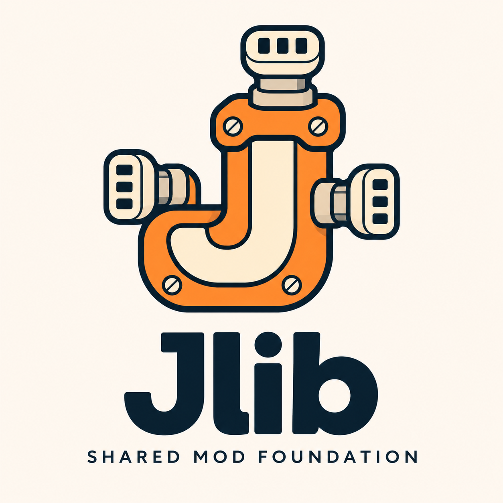

# Jlib



Jlib 是《缺氧》（Oxygen Not Included）的共享前置 Mod，基于 [Peter Han 的 PLib](https://github.com/peterhaneve/ONIMods)，保留 `PeterHan.PLib.*` 命名空间。依赖它的 Mod 共用一份启用的 `Jlib.dll`，由同一个提供者处理配置、界面、按键和公共运行时接口。

当前源码版本为 **0.3.10**，程序集版本为 **0.3.10.0**，公共 ABI 仍为 **1**。本仓库只包含 Jlib、所需的 PLib 模块、测试及打包配置。Jlib 的作用是提供共享接口与兼容性校验；帧率收益需要在具体游戏场景测量。

## 玩家安装

1. 订阅并启用 [Jlib 前置 Mod](https://steamcommunity.com/sharedfiles/filedetails/?id=3835083839)。
2. 在游戏 Mods 列表将它排在依赖它的 Mod 前面，重启游戏。
3. 同一 static ID `LIghtJUNction.Jlib` 只启用一份提供者；本地副本和工坊副本不要同时启用。

Jlib 的选项界面可查看依赖它的 Mod。遇到版本不匹配时，应核对游戏实际加载的 Jlib，以及它的版本、ABI 和来源。

**NuGet 包供开发时引用，游戏仍需安装并启用 Jlib 前置 Mod。** 工坊包、源码分支与 NuGet 的已发布版本可能不同，请分别核对。

## 这一轮改进了什么

| 改进 | 实际作用与边界 |
| --- | --- |
| 主线程派发有预算 | 一帧最多取 128 个回调，并在回调之间检查约 4 ms 的预算；不能中断单个耗时回调，整帧耗时还包括游戏与其他 Mod 的工作 |
| U60 纹理回调适配 | 解析旧方法或受支持的新委托布局，不执行类型静态初始化；未知布局给出原因并跳过相应补丁 |
| 多组分数据可用性 | 0.3.10 区分“已知为零”和“尚未计算”；调用者先检查压力、分压和体积分数的可用性 |
| 消费者所有权与共享提供者检查 | 显式关联消费者程序集和 Mod，校验 ABI 与最低版本，减少配置归属和重复打包问题 |

当前 OniSim 不提供已校准的压力与分压。Jlib 会保留这种“未知”状态；缺少液体占格数据时，相关 Vent 判断回到原版路径。质量和温度来自提供者，库存应从质量字段读取。

本轮独立宿主通过 **2,379 个断言**，并完成 `net48`、`netstandard2.1` 构建与元数据检查。宿主不执行游戏 DLL；其他 Mod 组合、渲染路径及长时间游戏仍需分别验证。接口细节见[开发指南](Jlib/README.md)和[更新记录](Jlib/CHANGELOG.md)。

## Mod 开发引用

NuGet 包：[LIghtJUNction.Jlib](https://www.nuget.org/packages/LIghtJUNction.Jlib)。下面以源码版本举例；使用 NuGet 前先确认该版本已经发布，或引用本仓库源码构建。

```xml
<PackageReference Include="LIghtJUNction.Jlib" Version="0.3.10" ExcludeAssets="runtime" />
```

源码 `ProjectReference` 的 `Private` 应为 `false`。不要把 `Jlib.dll` 或 `PLib*.dll` 合并、复制进消费者的发行包。

消费者必须在 ONI 枚举依赖 Jlib 的实现类型之前，验证并加载实际启用的提供者。请在枚举前的引导阶段执行检查，随后才进入实现的 `OnLoad`。实现程序集加载后，再用 `JlibApi.RegisterConsumer` 建立 Mod 所有权关系。

| 使用的接口 | 最低 Jlib 版本 |
| --- | --- |
| `ReplaceSimDll` / `ReplaceNativeLibrary` | 0.3.0 |
| `IMulticomponentCellBatchProvider`，一次至多 128 个连续格子 | 0.3.2 |
| `PropertyTextureCallbackTarget.TryResolve` | 0.3.9 |
| 压力与体积分数可用性字段 | 0.3.10 |

原生库映射只能在受支持的 Unity Mono 进程、`Game.Instance` 创建前设置；映射变更需要重启，替代库的 ABI 校验由调用方负责。PLib 组件协议仍为 `4.25.0.0`。

## 从源码构建

需要 .NET 10 SDK（测试工程使用 `net10.0`）和本机合法安装的《缺氧》。将 `OniManagedPath` 指向游戏的 `OxygenNotIncluded_Data/Managed`：

```sh
dotnet build Jlib/Jlib.csproj -c Release -p:OniManagedPath="/path/to/OxygenNotIncluded_Data/Managed"
dotnet pack Jlib/Jlib.csproj -c Release --no-build -p:OniManagedPath="/path/to/OxygenNotIncluded_Data/Managed"
```

也可以设置 `ONI_MANAGED_PATH`。仓库不保存或分发游戏引用 DLL。目标为 `net48` 与 `netstandard2.1`，游戏前置使用 `net48`：

| 输出 | 用途 |
| --- | --- |
| `artifacts/Jlib.zip` | 游戏 Mod 压缩包 |
| `artifacts/mod/Jlib/` | 可本地安装的 Mod |
| `artifacts/nuget/*.nupkg` | 开发引用包 |

Jlib 随 [OniMods](https://github.com/LIghtJUNction/OniMods) 集成；实际发布步骤与验证要求见该仓库的发布文档。

## 本地验证

```sh
dotnet run --project Jlib.Tests/Jlib.Tests.csproj -c Release
dotnet run --project Jlib.Tests/Jlib.Tests.csproj -c Release -- --inspect Jlib/bin/Release/net48/Jlib.dll Jlib/bin/Release/netstandard2.1/Jlib.dll
```

第二条命令检查先前构建的程序集。Unity/Mono、Harmony 补丁、UI、存读档及实际加载顺序仍需在游戏中验证。

## 来源与许可证

继承的 PLib 代码保留 Peter Han 的 MIT 版权和许可；Jlib 新增代码同样使用 MIT。项目采用 AI 生成开发与迭代；继承的第三方代码及素材以原作者署名和许可证为准。

见 [LICENSE](LICENSE)、[第三方声明](Jlib/THIRD-PARTY-NOTICES.md)和[上游来源](UPSTREAM.toml)。反馈时请附游戏版本、实际加载的 Jlib 版本、依赖 Mod 列表与最小复现：[问题反馈](https://github.com/LIghtJUNction/Jlib/issues)。
